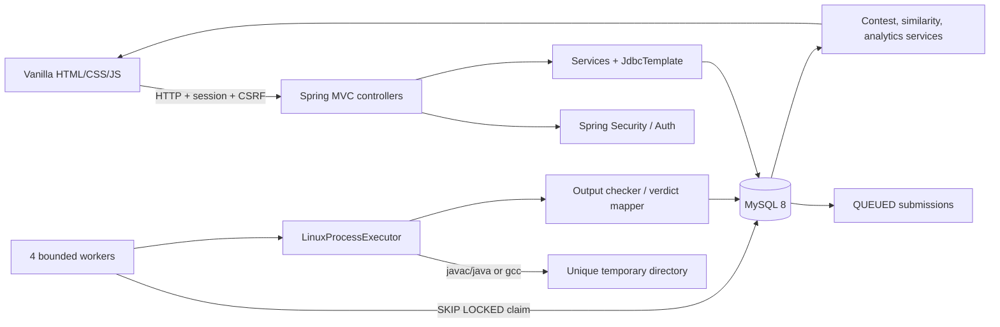
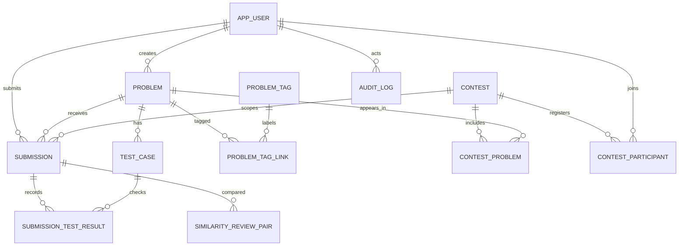

# CodePulse

CodePulse is a small Java 17/Spring Boot coding-practice and mini-contest app. It uses JDBC and MySQL (no ORM), vanilla browser JavaScript, and a bounded Linux worker pool for Java/C submissions.

> **Sandbox warning:** This is an interview/demo project, not a safe public code-hosting service. The process runner uses Linux limits but is not a security boundary. Read [docs/SECURITY.md](docs/SECURITY.md) before exposing it to users.

## What is implemented

- Session login and student registration, BCrypt password hashes, CSRF, role-checked admin routes, failed-login lockouts, audit events, request-size and submission-rate guards.
- Public problem listing/detail, admin problem and test-case creation, sample-only public test data.
- Queued submissions, four Linux workers, MySQL `FOR UPDATE SKIP LOCKED` claims, startup recovery, Java/C compile-and-run, capped output, verdicts, and owner-only results.
- Timed contest registration and ICPC-style scoreboard, Jaccard similarity review for admins, and API-backed canvas analytics.
- Three ordered SQL scripts seed seven problems, test cases, two demo accounts, and a warm-up contest.

## Architecture



### ER diagram



## Linux setup (Ubuntu)

The execution worker requires Linux utilities (`setsid`, `timeout`, `bash`, `ulimit`) plus `javac` and `gcc`. The current development host is Windows; run the full app and runner on Linux or WSL2 Ubuntu.

```bash
sudo apt update
sudo apt install openjdk-17-jdk maven mysql-server gcc
java -version
javac -version
mvn -version
mysql --version
gcc --version
```

Create the application database account (use a private local password):

```bash
sudo mysql
```

```sql
CREATE USER 'codepulse'@'localhost' IDENTIFIED BY 'replace-with-a-local-password';
GRANT ALL PRIVILEGES ON codepulse.* TO 'codepulse'@'localhost';
CREATE DATABASE codepulse CHARACTER SET utf8mb4 COLLATE utf8mb4_0900_ai_ci;
CREATE DATABASE codepulse_test CHARACTER SET utf8mb4 COLLATE utf8mb4_0900_ai_ci;
GRANT ALL PRIVILEGES ON codepulse_test.* TO 'codepulse'@'localhost';
EXIT;
```

Apply migrations in filename order to an empty database. `V1` creates/selects `codepulse`; `V2` adds similarity review; `V3` seeds the demo data.

```bash
for migration in src/main/resources/db/migration/V*.sql; do
  sudo mysql < "$migration"
done
```

Configure the app connection and build:

```bash
export DB_URL='jdbc:mysql://localhost:3306/codepulse'
export DB_USER='codepulse'
export DB_PASSWORD='replace-with-a-local-password'
mvn clean test package
mvn spring-boot:run
```

Open `http://localhost:8080`. Register a student account or use the seeded **development-only** accounts:

| Role | Username | Password |
|---|---|---|
| Student | `student` | `CodePulseStudent17!` |
| Admin | `admin` | `CodePulseAdmin17!` |

Change or remove these accounts before any shared deployment. Do not commit local credentials.

On Windows, the application may start on a free port, but the worker deliberately does not start. No code submissions will be executed there; MySQL and GCC are also required for the full feature flow.

## API summary

All state-changing requests require a CSRF token. Fetch `GET /api/auth/csrf`, retain its cookie, then send the returned value in `X-XSRF-TOKEN`.

| Method | Route | Access | Purpose |
|---|---|---|---|
| GET | `/api/auth/csrf` | Public | Get CSRF token |
| POST | `/api/auth/register` | Public + CSRF | Register as `STUDENT` |
| POST | `/api/auth/login` | Public + CSRF | Create session |
| POST | `/api/auth/logout` | Authenticated + CSRF | End session |
| GET | `/api/auth/me` | Authenticated | Current account |
| GET | `/api/problems` | Authenticated | Published problem list |
| GET | `/api/problems/{slug}` | Authenticated | Problem and visible samples |
| POST | `/api/admin/problems` | Admin + CSRF | Create problem |
| POST | `/api/admin/problems/{id}/test-cases` | Admin + CSRF | Add sample/hidden test |
| PUT | `/api/admin/problems/{id}/published` | Admin + CSRF | Publish/unpublish |
| POST | `/api/submissions` | Authenticated + CSRF | Queue Java/C submission |
| GET | `/api/submissions/mine` | Authenticated | Recent personal submissions |
| GET | `/api/submissions/{id}` | Owner + authenticated | Poll result; hidden inputs/expected outputs are never returned |
| GET/POST | `/api/contests`, `/api/contests/{id}/register` | Authenticated | List/register |
| GET | `/api/contests/{id}/scoreboard` | Authenticated | Scoreboard |
| GET | `/api/analytics/overview` | Authenticated | Canvas chart data |
| GET | `/api/admin/similarity/review` | Admin | List high-overlap pairs |
| POST | `/api/admin/similarity/{id}/review` | Admin + CSRF | Mark a pair reviewed |

## Tests and benchmark status

`mvn test` currently reports **33 tests total**: 25 pass on this Windows host and 8 are conditionally skipped (7 Linux process-runner tests and 1 MySQL concurrency test). The integration tests must be run on the target Linux/MySQL environment:

```bash
mvn test
mvn -Dcodepulse.mysql.integration=true \
  -Dcodepulse.mysql.test.url='jdbc:mysql://localhost:3306/codepulse_test' \
  -Dcodepulse.mysql.test.username=codepulse \
  -Dcodepulse.mysql.test.password='your-local-test-password' test
```

The queue test is destructive only inside a database whose name ends in `_test`; it drops and recreates its `submission` and `problem` tables.

**Throughput has not been measured.** This machine has no MySQL or GCC and is not Linux, so a local submissions/minute figure would be misleading. Measure on the target Linux machine after migrations: submit a fixed batch of known-valid solutions, wait for terminal verdicts, then report `completed submissions / elapsed minutes` alongside CPU, memory, worker count, and test-case count. Do not treat this as a production capacity estimate.

## Screenshot slots

<!-- Screenshot slot: problem list and solver -->
<!-- Screenshot slot: contest scoreboard -->
<!-- Screenshot slot: analytics dashboard -->

## Design and security notes

- [docs/DESIGN.md](docs/DESIGN.md): transaction boundaries, queue claims, execution choices, and trade-offs.
- [docs/SECURITY.md](docs/SECURITY.md): threat model and explicit sandbox limits.
- [docs/INTERVIEW_NOTES.md](docs/INTERVIEW_NOTES.md): interview questions with candid answers.
